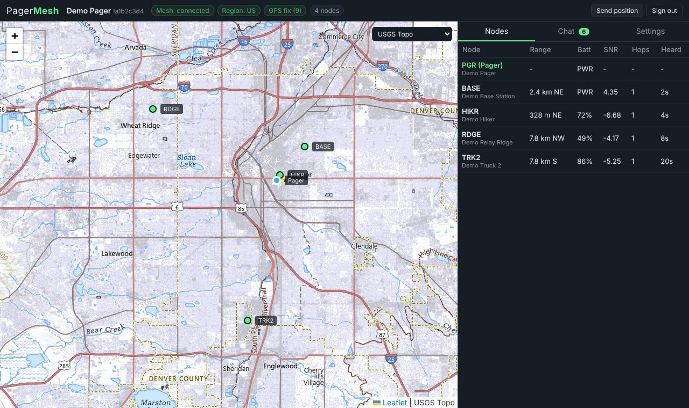
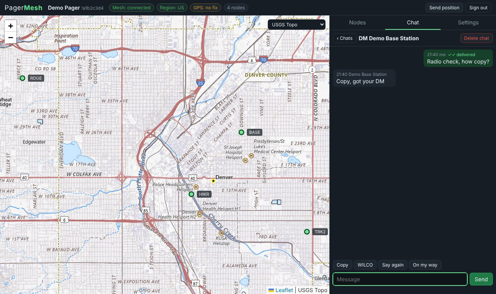
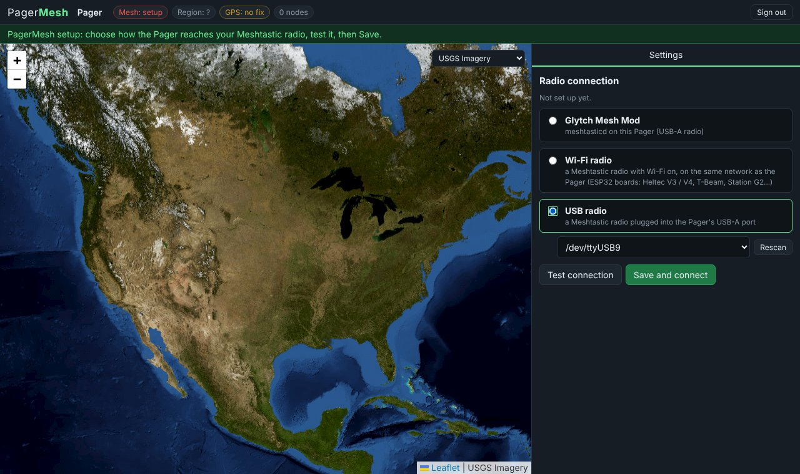
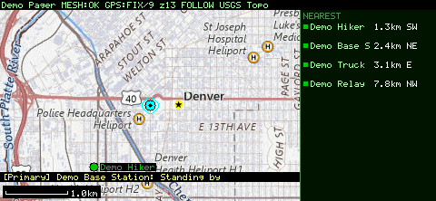
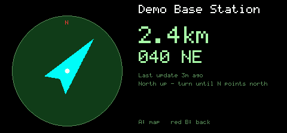

# PagerMesh – Meshtastic on the [WiFi Pineapple Pager](https://hak5.org/products/wifi-pineapple-pager)

<p align="center"></p>

[](https://www.buymeacoffee.com/sect0101)

A community payload that makes the **Hak5 WiFi Pineapple Pager** the screen, GPS and map for a **Meshtastic** radio (the **Glytch Mesh Mod**, a **Wi-Fi radio** such as a Heltec V3, or a **USB radio**): mesh chat, a node list with range and bearing, mesh nodes on the Pager map, the Pager's GPS position over the mesh, and a browser web console.

> **Version 1.0.0.** Tested on a Pager with a Heltec radio over Wi-Fi. Reports from Glytch Mesh Mod and USB radio users are welcome: see [Testing](library/user/general/PagerMesh/README.md#-testing).

**Written in DuckyScript™ + Bash (and Python standard library) for the WiFi Pineapple Pager. A community payload, not supported or guaranteed by Hak5, Meshtastic or Glytch.** See [Legal](#legal).

Sister project: [PagerTAK](https://github.com/SECT0101/PagerTAK) puts the Pager on TAK. The layout follows the official [hak5/wifipineapplepager-payloads](https://github.com/hak5/wifipineapplepager-payloads) library, so the payload folder can be copied straight to the Pager.



---

## Payloads

| Payload | Category | Description |
|---|---|---|
| [PagerMesh](library/user/general/PagerMesh) | user / general | Meshtastic on the Pager through the radio's client API (Glytch Mesh Mod via meshtasticd, Wi-Fi radio on TCP 4403, or USB serial): chat on every channel and direct messages with delivery ticks, conversations with 7-day history and delete, node list (range / bearing from the Pager GPS, battery, SNR, hops, last heard), nodes on the Pager map with *Navigate to*, Pager GPS position over the mesh, and a password-protected **web console**. Setup on the Pager or in a web browser. For the Mesh Mod it runs Glytch's Meshtastic payload to install, start and auto-start meshtasticd. |

## Screenshots

All screenshots use made-up demo nodes from the simulator.





On the Pager: the map with the nearest-nodes list, and *Navigate to* a node.

<p align="center"> </p>

## Quick start

1. Download `PagerMesh-<version>.zip` from [Releases](../../releases) and copy the `PagerMesh` folder to `/root/payloads/user/general/PagerMesh/`.
2. Run **PagerMesh** on the Pager and choose setup **On the Pager** or **In a web browser**, then your radio:
   - **Wi-Fi radio**: turn on Wi-Fi in the radio (Meshtastic app > Network), on the same network as the Pager, and enter its IP address.
   - **USB radio**: plug it into the Pager's USB-A port and pick its port.
   - **Glytch Mesh Mod**: put Glytch's Meshtastic `payload.sh` in `/root/payloads/user/general/Meshtastic/` ([glytchtech/Pager-Mod-Docs](https://github.com/glytchtech/Pager-Mod-Docs/tree/main/Mesh)); PagerMesh installs and starts meshtasticd. On current Pager firmware the installer needs the one-line kernel fix from [PR #5](https://github.com/glytchtech/Pager-Mod-Docs/pull/5).
3. Set the radio's **Region** and node name in *Settings > Radio settings* (or the Meshtastic phone app).

Full usage: [library/user/general/PagerMesh/README.md](library/user/general/PagerMesh/README.md).

## Repository layout

```
library/
└── user/
    └── general/
        └── PagerMesh/
            ├── payload.sh          # the payload: setup, menus, chat, GPS (Bash + Pager DuckyScript)
            ├── README.md           # full usage and configuration
            ├── mesh/
            │   ├── pagermesh.py    # mesh service: radio client (TCP / USB serial), node list, chat, position
            │   ├── meshproto.py    # Meshtastic protobuf, TCP and serial stream framing (standard library only)
            │   ├── radiocfg.py     # radio settings and channels (changes only the edited fields)
            │   ├── sigint.py       # packet log, traffic stats, trails, pcap / CSV export
            │   └── takbridge.py    # mesh <-> TAK bridge (CoT contacts, GeoChat)
            ├── map/
            │   ├── pagermesh_map.py  # Pager map viewer (from PagerTAK)
            │   ├── pagerfb.py        # pure-Python screen and button driver (from PagerTAK)
            │   ├── pagermesh_qr.py   # channel QR code on the Pager screen
            │   ├── qrcodegen.py      # QR code generator (Project Nayuki, MIT)
            │   └── sources/          # basemaps (ATAK map source XML)
            ├── certs/            # TAK client certificate for the bridge (never committed)
            └── web/
                ├── pagermesh_web.py  # web console server
                └── static/           # page, script, style, Leaflet
tools/
├── fake_meshtasticd.py     # simulated meshtasticd with demo nodes, for testing without a radio
└── fake_takserver.py       # stand-in TAK Server (TCP) for testing the mesh <-> TAK bridge
```

## Testing without a radio

`tools/fake_meshtasticd.py` speaks the Meshtastic TCP API (like meshtasticd or a Wi-Fi radio) with demo nodes that move, chat and send telemetry, and acks direct messages. It also takes settings changes (and restarts like a real radio), answers traceroutes and position requests, sends a waypoint and an encrypted packet now and then, and prints everything PagerMesh would put on air. `tools/fake_takserver.py --port 8087` prints the CoT the bridge sends and sends one GeoChat back.

```sh
python3 tools/fake_meshtasticd.py --port 4403 --fast
python3 library/user/general/PagerMesh/mesh/pagermesh.py --check                                   # OK !a1b2c3d4 Demo Pager ...
python3 library/user/general/PagerMesh/mesh/pagermesh.py --conn wifi --host 127.0.0.1 --port 4403 --check
python3 library/user/general/PagerMesh/mesh/pagermesh.py --nodes
```

## Legal

WiFi Pineapple and DuckyScript are trademarks of Hak5 LLC. Meshtastic® is a registered trademark of Meshtastic LLC; meshtasticd is © Meshtastic LLC (GPL-3.0). The *M-Powered* badge on the PagerMesh shield is Meshtastic's community-project logo, shown as provided; it does not mean the project is endorsed by Meshtastic. The Glytch Mesh Mod and its payload are Glytch's. `qrcodegen.py` is © Project Nayuki (MIT License). This project is not affiliated with or endorsed by any of them.

Use radios only as your license and local rules allow (frequency band, power, duty cycle).

## License

[GPL-3.0](LICENSE)
